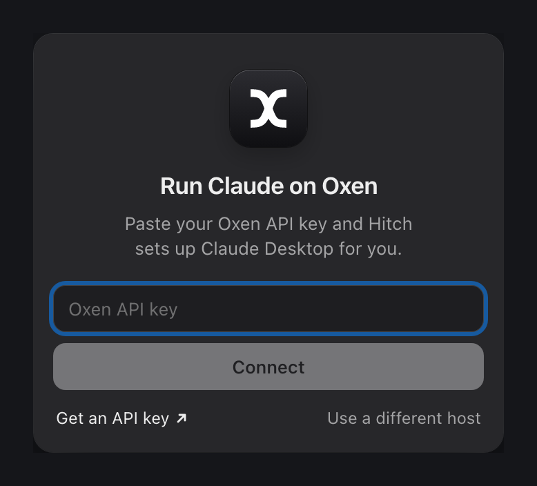
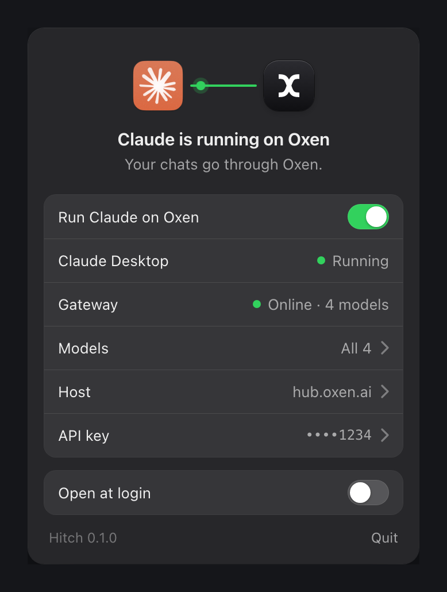
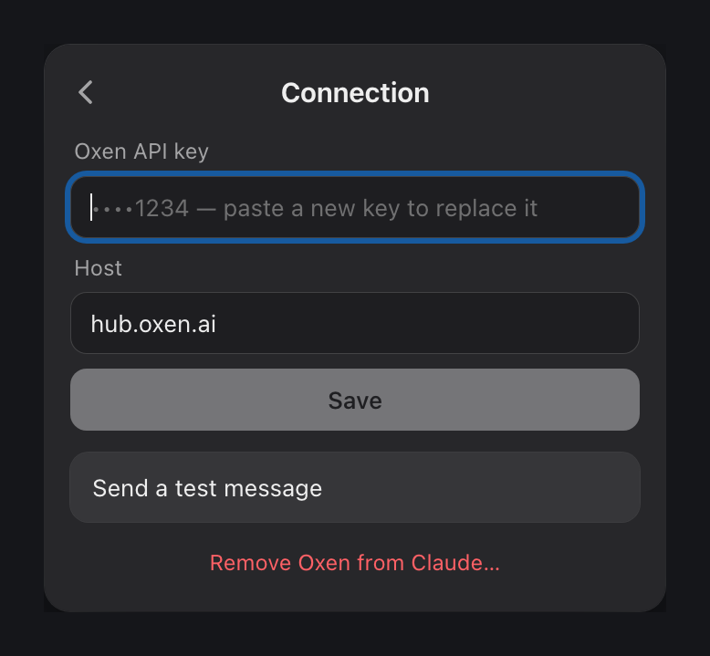

# Oxen Hitch

Run Claude Desktop on the [Oxen.ai](https://oxen.ai) gateway. Hitch lives in your menu bar: paste
your Oxen API key, click Connect, restart Claude. No developer mode, no config files.

## Install

1. **[Download the latest Hitch `.dmg`](https://github.com/Oxen-AI/OxenHitch/releases/latest)**
   (under **Assets** on that page).
2. Open the `.dmg` and drag **Hitch** into **Applications**.
3. Open Hitch from Applications. Its icon, the Oxen **x**, appears in the menu bar.

Hitch runs on Apple Silicon and Intel Macs with macOS 12 or later, and needs the
[Claude desktop app](https://claude.com/download).

## Set up

### 1. Paste your Oxen API key

Click the Oxen **x** in the menu bar, paste your key and click **Connect**. Hitch checks the key
with Oxen before it changes anything. If the Oxen CLI already saved a key on this Mac, Hitch
finds it and there is nothing to paste.



### 2. Restart Claude

Claude reads its settings only when it opens, so Hitch asks you to restart it. Click **Restart
Claude** and Hitch quits and reopens it for you. It never restarts Claude on its own.


### 3. You're on Oxen

Claude now runs on Oxen. The home screen shows whether Claude is running and whether the Oxen
gateway is reachable. **Run Claude on Oxen** switches Claude back to signing in with Anthropic,
and on again, without losing your key.



### Choose your models

**Models** lists every chat model Oxen offers. Leave it on **All models**, or pick the ones you
want in Claude's model menu; the first one you pick is the default. The refresh button fetches
the latest list from Oxen.


### Change the key or the host

**Host** and **API key** on the home screen open the connection settings. Replace the key, point
Hitch at a different Oxen host, or send a test message to check the whole path. **Remove Oxen
from Claude** puts Claude back the way it was before Hitch.



Hitch is macOS only for now. Windows and Linux are planned; the core already knows where Claude
keeps its settings on each.

## Develop

Requires Rust, Node 22+ and pnpm.

```sh
pnpm install
pnpm tauri dev      # run the app
pnpm test           # UI and script tests
pnpm test:rust      # core tests
pnpm check          # everything CI runs
pnpm tauri build    # build Hitch.app and a .dmg
```

To try it without changing your real Claude setup:

```sh
HITCH_CLAUDE_DIR=/tmp/hitch-sandbox/Claude-3p pnpm tauri dev
```

## Release

Releases are cut by GitHub Actions.

1. Go to **Actions → Bump version → Run workflow** and choose patch, minor or major
   (or `gh workflow run bump-version.yml -f bump=patch`).
2. That raises the version everywhere, commits it to `main`, tags it `vX.Y.Z`, and starts the
   **Release** workflow.
3. Release runs the full checks, builds a universal macOS `.dmg`, and publishes it on the
   Releases page.

Pushing a `vX.Y.Z` tag by hand also starts a release, as long as the tag matches the version in
the code (`pnpm version check`).

## Learn more

- [`docs/01_project_brief.md`](docs/01_project_brief.md) — what Hitch is and how Claude Desktop's third-party mode works
- [`docs/02_tech_stack.md`](docs/02_tech_stack.md) — the stack, layout and commands
- [`docs/03_decisions.md`](docs/03_decisions.md) — decisions and why
