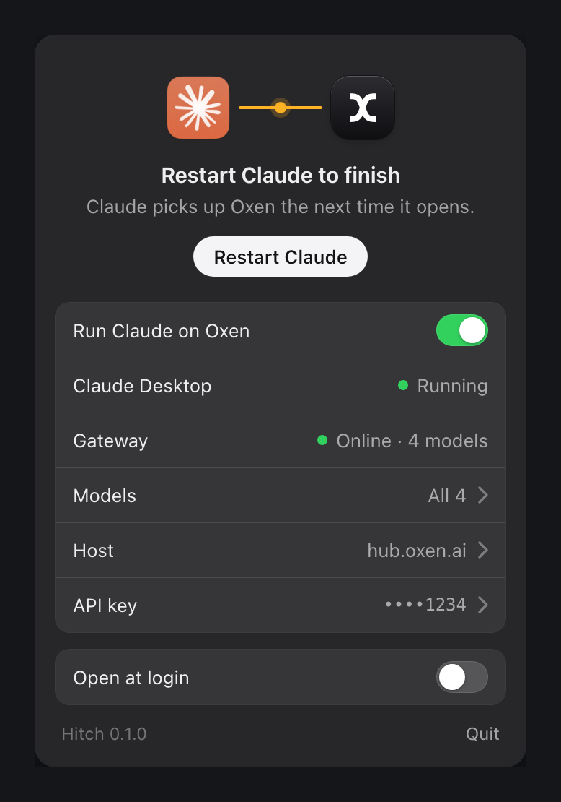
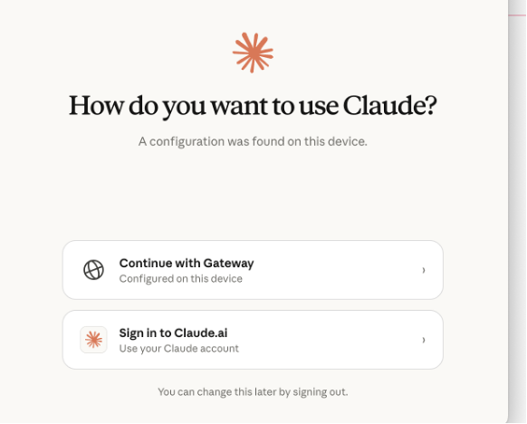
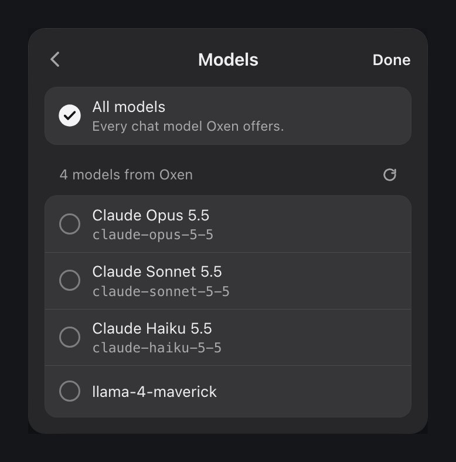
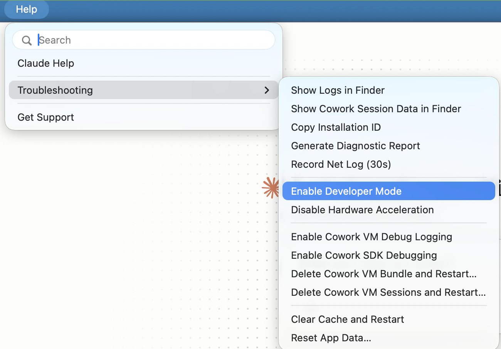
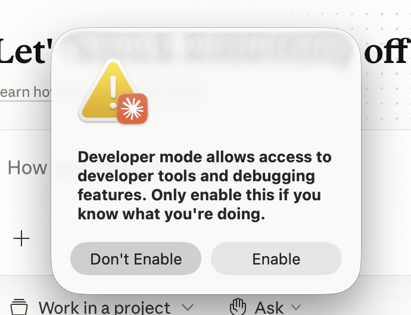
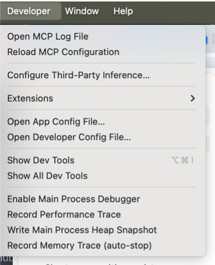
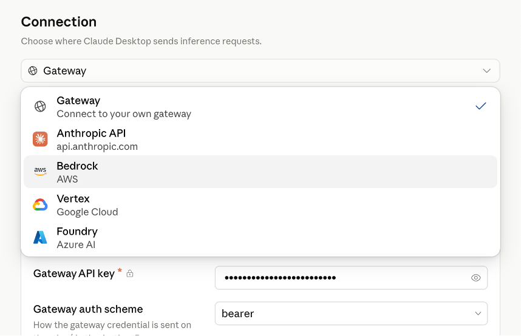

# Oxen Hitch

Run the Claude desktop app on [Oxen.ai](https://oxen.ai). Hitch lives in your menu bar: paste your
Oxen API key, click Connect, restart Claude. No developer mode, no settings files to edit.

**[Download the latest Hitch for Mac](https://github.com/Oxen-AI/OxenHitch/releases/latest)**

- [Before you start](#before-you-start)
- [Install](#install)
- [Set up](#set-up)
- [Everyday use](#everyday-use)
- [Claude Code](#claude-code)
- [Set up by hand with Developer Mode](#set-up-by-hand-with-developer-mode)
- [Develop](#develop) · [Release](#release)

## Before you start

You need three things:

1. **A Mac** with macOS 12 or later, Apple Silicon or Intel.
2. **The Claude desktop app.** [Download it here](https://claude.com/download) and move it to
   Applications. You do not need to sign in to it.
3. **An Oxen API key.** Create one in your account settings on [oxen.ai](https://www.oxen.ai).

## Install

1. Open the [latest release](https://github.com/Oxen-AI/OxenHitch/releases/latest) and download
   the `.dmg` file under **Assets**.
2. Open the `.dmg` and drag **Hitch** into **Applications**.
3. Open Hitch from Applications. It has no window of its own: its icon, the Oxen **x**, appears
   in the menu bar at the top right of your screen.

## Set up

### 1. Paste your Oxen API key

Click the Oxen **x** in the menu bar, paste your key and click **Connect**. Hitch checks the key
with Oxen before it changes anything. If the Oxen command-line tool already saved a key on this
Mac, Hitch finds it and there is nothing to paste.


### 2. Restart Claude

Claude reads its settings only when it opens. Click **Restart Claude** and Hitch quits and
reopens it for you. The first time, macOS asks whether Hitch may control Claude: click **Allow**.
Hitch never restarts Claude on its own.



If Claude opens on a screen asking **How do you want to use Claude?**, choose **Continue with
Gateway**.



### 3. You're on Oxen

Claude now runs on Oxen: chat, Cowork and the Code tab all go through your Oxen account. Pick a
model from Claude's model menu as usual. Hitch's home screen shows whether Claude is running and
whether Oxen is reachable.


## Everyday use

**Switch back to Anthropic.** Turn off **Run Claude on Oxen** and restart Claude. Claude goes
back to signing in with Anthropic. Turn it on again to return to Oxen; your key stays saved.

**Choose your models.** **Models** lists every chat model Oxen offers, including ones that are
not Claude. Leave it on **All models**, or pick the ones you want in Claude's model menu; the
first one you pick is the default. The refresh button fetches the latest list from Oxen.



**Change the key or the host.** **Host** and **API key** open the connection settings. Replace
the key, point Hitch at a different Oxen host, or send a test message to check the whole path.


**Remove Hitch.** In the connection settings, **Remove Oxen from Claude** puts Claude back the
way it was before Hitch. Then quit Hitch and drag it from Applications to the Trash.

## Claude Code

**The Code tab inside the Claude desktop app** needs nothing extra. Once Hitch has connected
Claude to Oxen, it runs on Oxen too.

**Claude Code in the terminal** (the `claude` command) keeps its own settings, and Hitch does not
change them. Point it at Oxen with two environment variables:

```sh
export ANTHROPIC_BASE_URL=https://hub.oxen.ai/api/ai
export ANTHROPIC_AUTH_TOKEN="your-oxen-api-key"
claude
```

To make that permanent, add the two `export` lines to `~/.zshrc` and open a new terminal window.

Choose a model with `--model`, using a name from Hitch's **Models** screen (the grey text under
each model):

```sh
claude --model claude-sonnet-5-5
```

For a model that is not Claude, also set the model Claude Code uses for its background work, which
is otherwise a Claude model:

```sh
ANTHROPIC_DEFAULT_HAIKU_MODEL=gpt-5-mini claude --model gpt-5-mini
```

To go back to Anthropic, remove the two variables (`unset ANTHROPIC_BASE_URL ANTHROPIC_AUTH_TOKEN`).

## Set up by hand with Developer Mode

You do not need this if you use Hitch. It is here for when you can't install Hitch, or want to
see what Hitch set up. Claude's Developer Mode has a settings screen for the same thing.

1. In Claude, open **Help → Troubleshooting → Enable Developer Mode**.

   

2. Click **Enable** in the warning. Claude restarts.

   

3. A **Developer** menu now sits next to **Window**. Open **Developer → Configure Third-Party
   Inference…**

   

4. Under **Connection**, choose **Gateway**.

   

5. Fill in the form:

   | Field | Value |
   |---|---|
   | Credential kind | Static API key |
   | Gateway base URL | `https://hub.oxen.ai/api/ai` |
   | Gateway API key | your Oxen API key |
   | Gateway auth scheme | bearer |

6. Click **Test connection**. When it succeeds, click **Apply locally**.
7. Quit Claude and open it again. When it asks **How do you want to use Claude?**, choose
   **Continue with Gateway**.

Set up this way, Claude's model menu lists only Oxen's Claude models. Hitch also adds the others
(GPT, Gemini, Llama and so on), which Claude would otherwise hide.

Developer Mode screenshots are from Stanford University IT's
[Claude Cowork guide](https://uit.stanford.edu/service/ai-api-gateway/userguide/claude-cowork).

## Develop

Requires Rust, Node 22+ and pnpm.

```sh
pnpm install
pnpm tauri dev      # run the app
pnpm test           # UI and script tests
pnpm test:rust      # core tests
pnpm check          # everything CI runs
pnpm tauri build    # build Hitch.app and a .dmg
```

To try it without changing your real Claude setup:

```sh
HITCH_CLAUDE_DIR=/tmp/hitch-sandbox/Claude-3p pnpm tauri dev
```

## Release

Releases are cut by GitHub Actions.

1. Go to **Actions → Bump version → Run workflow** and choose patch, minor or major
   (or `gh workflow run bump-version.yml -f bump=patch`).
2. That raises the version everywhere, commits it to `main`, tags it `vX.Y.Z`, and starts the
   **Release** workflow.
3. Release runs the full checks, builds a universal macOS `.dmg`, and publishes it on the
   Releases page.

Pushing a `vX.Y.Z` tag by hand also starts a release, as long as the tag matches the version in
the code (`pnpm version check`).

## Learn more

- [`docs/01_project_brief.md`](docs/01_project_brief.md) — what Hitch is and how Claude Desktop's third-party mode works
- [`docs/02_tech_stack.md`](docs/02_tech_stack.md) — the stack, layout and commands
- [`docs/03_decisions.md`](docs/03_decisions.md) — decisions and why
